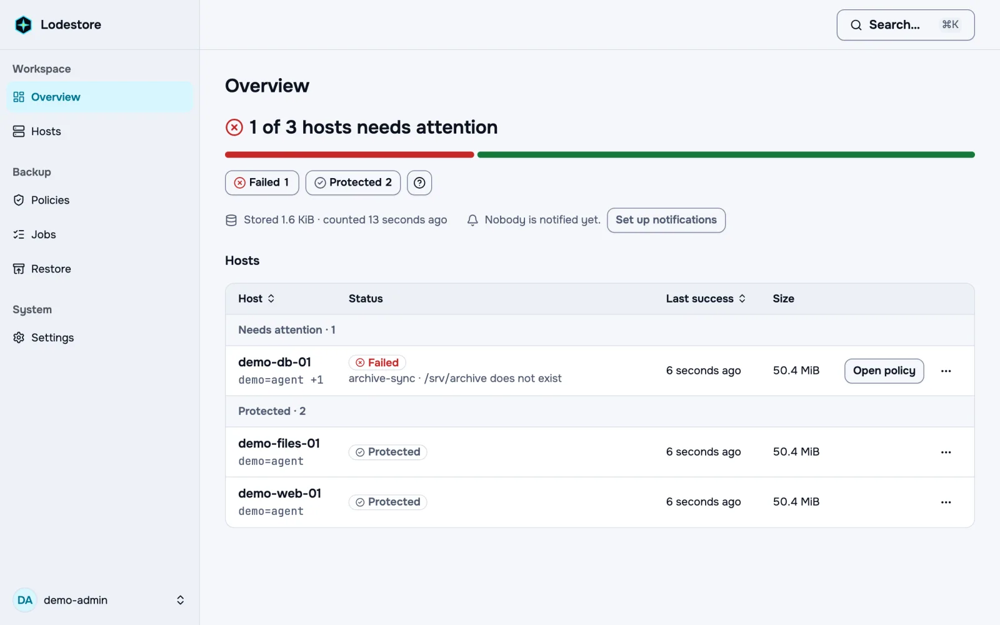

<div align="center">


# Lodestore

**Centralized, encrypted backup for your server fleet. Your data goes straight to your own storage, and a restore needs only the repository and a password.**

[](https://github.com/lodestore/lodestore/actions/workflows/ci.yml)
[](#license)
[](https://github.com/lodestore/lodestore/releases)

</div>


<picture>
  <source media="(prefers-color-scheme: dark)" srcset="./docs/src/assets/media/overview.dark.webp">
  
</picture>

## What is Lodestore

Lodestore is a backup system for fleets of Linux hosts. A lightweight agent on each host writes deduplicated, encrypted data straight to S3-compatible object storage (AWS S3, MinIO, Ceph and others) or to a local or network folder such as NFS. The server only manages and catalogs, so it never sits in the data path and a restore works without it.

- **Restore needs only the repository and a key.** The bucket, plus the repository password or the recovery key, is enough to restore with the `lode` command line, even if the server is gone.
- **On S3-compatible storage, hosts cannot delete their own backups.** An agent holds a key without delete rights; deletion and cleanup run only on the server, and work with S3 Object Lock and versioning.
- **One place to run many hosts.** Schedules and retention as YAML policies, alerts to Telegram, Slack, email and webhooks, Prometheus metrics, a fleet-wide search for a file across every host's snapshots, and agent updates that the agent installs only after checking a signature.
- **Cleanup that is safe around running backups.** Two-phase garbage collection: mark, wait longer than the longest backup, check again, then delete. A dry run is always available.
- **Encrypted and deduplicated.** Data is deduplicated across the snapshots and hosts of a repository, compressed, then encrypted with XChaCha20-Poly1305 before they leave the host. File names are not readable in the bucket either.
- **One server binary with a web interface.** Run it as a Docker image, a static binary or a Helm chart, with SQLite by default and PostgreSQL for production.

## Quickstart

Start the server with one command, then connect a host and take a first backup in about ten minutes. Set the address of the machine that runs the server, reachable from the host you want to back up, and the release to install:

```sh
export LODESTORE_HOST=192.0.2.10
export LODESTORE_VERSION=0.1.0
docker run -d --name lodestore \
  -p 8080:8080 -p 8443:8443 \
  -v lodestore-data:/var/lib/lodestore \
  -e LODESTORE_PUBLIC_URL="http://$LODESTORE_HOST:8080" \
  -e LODESTORE_GRPC_PUBLIC_ADDRESS="$LODESTORE_HOST:8443" \
  ghcr.io/lodestore/lodestore:$LODESTORE_VERSION
```

Then:

1. Print the one-time setup link and open it in a browser to create the administrator:

   ```sh
   docker logs lodestore 2>&1 | grep 'setup?token='
   ```

2. In the setup wizard, connect your bucket (or a folder), choose a repository password and save the recovery key.
3. Open **Hosts**, choose **Add host** and run the command it shows as root on the host you want to back up. The host appears as online within seconds.
4. Open **Policies**, create a policy for the folders to back up, choose the host and run it. When the job succeeds, the snapshot is in your bucket.
5. Open **Restore** to bring files back, or restore without the server:

   ```sh
   export LODE_REPOSITORY="s3:$S3_ENDPOINT/$S3_BUCKET"
   export LODE_PASSWORD_FILE=./repository-password
   lode restore latest --target ./restored
   ```

The quickstart uses plain HTTP so that it works on any network; put the server behind HTTPS for anything beyond a trial. Full walkthrough with the storage keys: <https://lodestore.github.io/lodestore/quickstart/>

## Installation

- **Docker:** the main way to run the server, with volumes, an unlock key and a reverse proxy. [Running the server with Docker](https://lodestore.github.io/lodestore/install/docker/)
- **Binary:** static Linux binaries for x86_64 and arm64 with minisign signatures, run under systemd. [Installing from release binaries](https://lodestore.github.io/lodestore/install/binary/)
- **Helm:** the chart is published next to the image in `ghcr.io`. [Deploying with Helm](https://lodestore.github.io/lodestore/install/helm/)

## Storage

Repositories live on S3-compatible object storage or in a local or network folder. On S3-compatible storage the agent key has no delete rights and Object Lock is available; in a folder the agent can delete and overwrite, so prefer object storage for data that a compromised host must not be able to destroy. See [Agent credentials](https://lodestore.github.io/lodestore/security/threat-model/#agent-credentials).

## Version 0.1 and roadmap

Version 0.1 backs up files and directories on Linux (x86_64 and arm64). Databases are covered by [dumping them in a pre-backup hook](https://lodestore.github.io/lodestore/recipes/database-backup-hook/).

Planned: Proxmox and Kubernetes backups, and more storage backends.

## Documentation

- [Quickstart](https://lodestore.github.io/lodestore/quickstart/)
- [Restore without the server](https://lodestore.github.io/lodestore/recipes/restore-without-server/)
- [Policies and retention](https://lodestore.github.io/lodestore/guides/policies/), [alerts](https://lodestore.github.io/lodestore/guides/alerts/), [cleanup](https://lodestore.github.io/lodestore/guides/gc/)
- [Threat model](https://lodestore.github.io/lodestore/security/threat-model/) and [how we test data safety](https://lodestore.github.io/lodestore/security/how-we-test/)
- Comparisons: [restic](https://lodestore.github.io/lodestore/compare/restic/), [Bareos](https://lodestore.github.io/lodestore/compare/bareos/), [Plakar](https://lodestore.github.io/lodestore/compare/plakar/)

## Contributing and security

Read [CONTRIBUTING.md](CONTRIBUTING.md) before opening a pull request. To report a vulnerability, see [SECURITY.md](SECURITY.md); please do not open a public issue for it.

## License

| Component | Crates | License |
|---|---|---|
| Agent | `lodestore-agent` | Apache-2.0 |
| Repository format | `lodestore-format` | Apache-2.0 |
| Protocol | `lodestore-proto` | Apache-2.0 |
| CLI (`lode`) | `lode-cli` | Apache-2.0 |
| Policy engine, test helpers | `lodestore-policy`, `lodestore-testkit` | Apache-2.0 |
| Server | `lodestore-server` | AGPL-3.0-only |

Apache-2.0 crates never depend on `lodestore-server` or any other AGPL crate; `scripts/check-license-boundary.sh` enforces this. The Apache-2.0 text is in [LICENSE](LICENSE), the AGPL-3.0 text in [crates/lodestore-server/LICENSE](crates/lodestore-server/LICENSE).
